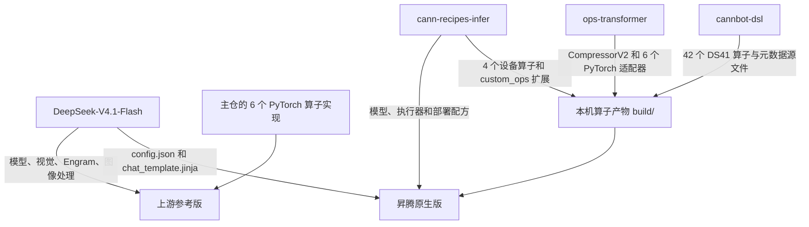

# DeepSeek-V4.1-Flash 微缩复现

用一条合成图文请求，观察 DeepSeek-V4.1-Flash 如何编码图像、预填充上下文，再逐步生成 token。两套入口都在本地构造词表、输入和测试权重，适合阅读模型前向流程，也适合在改动模型、执行器或算子后做回归检查。

| 想验证什么 | 运行哪一版 | 实际执行的代码 |
|---|---|---|
| 观察视觉编码、Engram、KV 压缩、稀疏索引、MoE 和草稿模型如何参与前向计算 | 上游参考版，支持 Linux x86_64 CPU 或单卡 Ascend 950PR | 直接构造官方 `Transformer`，用 6 个 PyTorch 张量实现补齐上游算子接口。[参考版入口](upstream/upstream_repro.py) |
| 验证图文请求能否经过调度器、设备算子和主模型，完成普通生成或 DSpark 草稿验证 | 昇腾原生版，单卡 Ascend 950PR | 由 `cann-recipes-infer` 的 `OfflineInference.generate()` 执行请求，并检查设备上的 logits。[原生版入口](native/executor_repro.py) |

## 运行复现

以下命令均从仓库根目录执行，两条路径可独立运行。

### 上游参考版

默认在 CPU 上运行，复用 `build/inference/` 中的模型文件并自动补齐缺项。可用 `--source DIR` 指定已有的完整目录，用 `--device npu:0` 选择可见的首张昇腾卡。[启动脚本](run_upstream_repro.sh) · [参考版说明](upstream/README.md)

```bash
bash run_upstream_repro.sh
```

### 昇腾原生版

下面以物理卡 `0` 为例，运行时替换为分配给你的卡号。默认依次执行普通生成和 DSpark。单独复跑某一项时，在命令末尾加上 `normal` 或 `dspark`。[启动脚本](run_native_repro.sh) · [原生版说明](native/README.md)

```bash
ASCEND_RT_VISIBLE_DEVICES=0 bash run_native_repro.sh
```

两种模式分别写入日志，可查看各自最后一行的 JSON。

```bash
tail -n 1 build/logs/normal.log build/logs/dspark.log
```

## 如何判断通过

三个用例通过时均以状态码 `0` 退出，并输出 `"result": "pass"`。CPU 参考版将结果打印到终端，昇腾原生版还会将结果写入对应日志。

| 用例 | 验收时看什么 | 单机实测结果 |
|---|---|---|
| CPU 参考版 | `stages` 记录位置 0、13、14，三步的 `logits_shape` 均为 `[1, 128]`，logits 有限且非全零 | 13 个 token 的图文预填充后完成两步解码。视觉编码器执行 1 次，6 个文本层各执行 3 次。 |
| 昇腾普通生成 | `calls.prefill` 为 1，`calls.vision` 和 `calls.decode` 均大于 0 | 视觉编码 1 次，解码调用 3 次，输出 3 个 token。 |
| 昇腾 DSpark | 满足普通生成的检查，且 `speculative_forwards` 中的计数之和大于 0 | 视觉编码 1 次，解码调用 11 次，完成 4 轮草稿验证，输出 5 个 token。 |

昇腾版的 `calls.decode` 统计解码阶段语言模型输出头的调用次数。DSpark 会对草稿进行验证，因此这个计数可以大于最终输出的 token 数。测试权重用于检查执行路径、输出形状和数值有效性。生成质量需要用真实权重评估，多卡通信需要在目标拓扑上验证。

## 依赖关系

箭头由提供方指向使用方。两版使用同一固定版本的官方文件。参考版读取模型实现，原生版读取配置和聊天模板，模型实现由 `cann-recipes-infer` 提供。[官方模型版本](https://huggingface.co/deepseek-ai/DeepSeek-V4.1-Flash/tree/314113f8a7dadb388215396ba5fbee2c610a04d6)



三个外部仓都固定在 `3rdparty/` 下。运行原生版时，执行器和模型直接从 `cann-recipes-infer` 导入，5 个设备算子和 1 个 C++ 扩展编译到 `build/native_build/`，适配器和 DSL 源文件位于 `build/python_ops/`。首次推理还会即时编译部分算子。CPU 参考版独立于这三个子模块。[子模块清单](.gitmodules) · [算子来源与构建说明](native/native_environment.md)

此前的独立验证中，上游参考版在未初始化子模块的工作树上通过了 CPU 测试。昇腾原生版的普通生成和 DSpark 分别从子模块加载了 80 和 81 个带源码文件的框架模块，构建和推理结束后子模块工作树干净。

## 许可证

子模块和仓外依赖保留各自的许可证与声明。[本项目许可证](LICENSE) · [第三方声明](Third_Party_Open_Source_Software_Notice)
